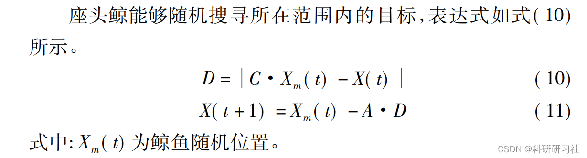
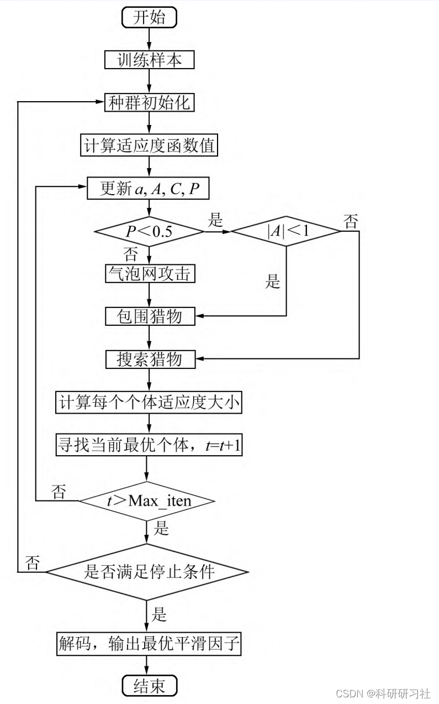
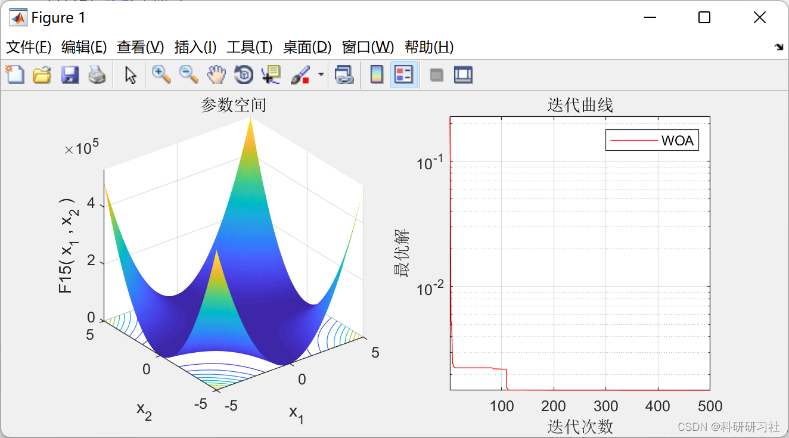

# Whale Optimization Algorithm (Matlab Code Implementation)

1. Overview
In 2016, the WOA was proposed by Mirjalili et al. [6.], which is a novel and powerful group intelligence optimization algorithm. It not only possesses strong search capabilities and positive feedback characteristics but also achieves global optimization. The algorithm includes three behaviors: encircling prey, bubble net attack, and searching for prey.

Editor
2.1 Encircling Prey
2.2 Bubble Net Attack
2.3 Searching for Prey

3. Flowchart
4. Running Results
5 Matlab Code and Detailed Article This article only showcases part of the code; all codes can be found in:

## Images

<!-- PAYMENT_BLOCK -->

## Get this dataset

- Payment link (Stripe): [Buy now](https://buy.stripe.com/3cs8yP7sY87d0vu9AB)
- Payment QR code: 

<!-- /PAYMENT_BLOCK -->
